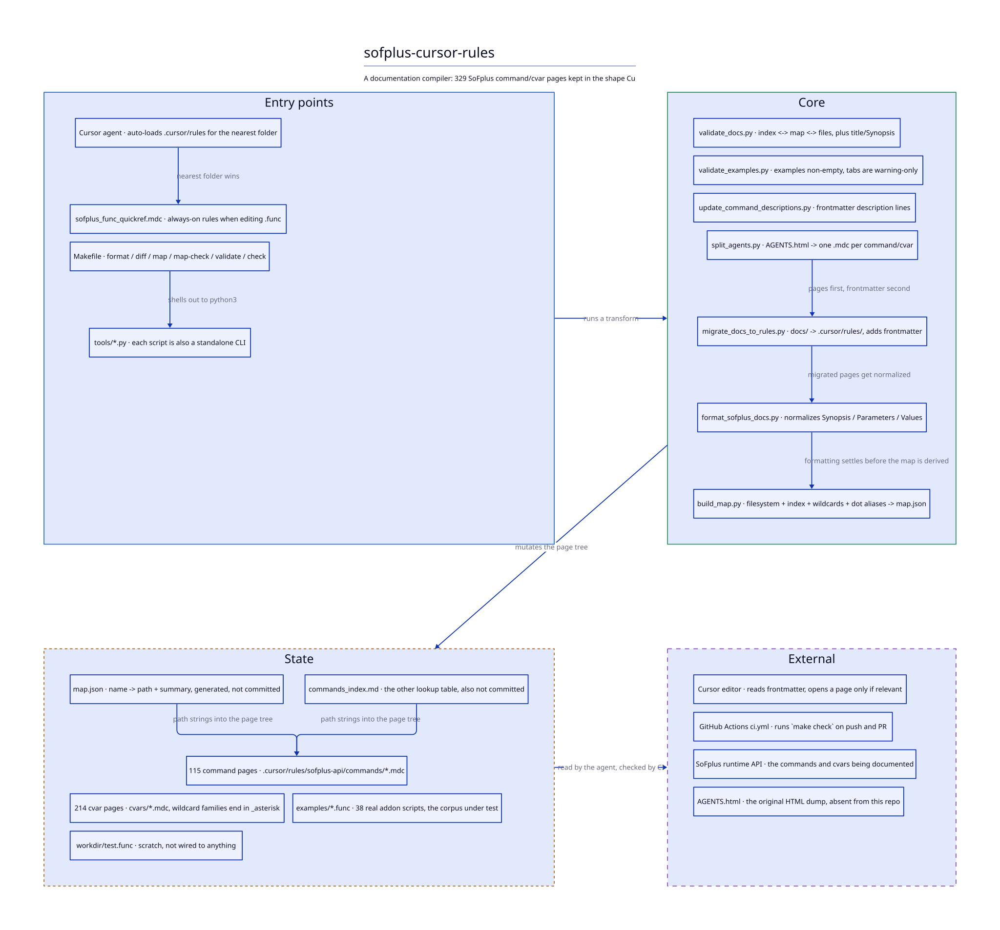

# sofplus-cursor-rules

SoFplus command and cvar documentation, formatted as Cursor rules — 329 pages in `.cursor/rules/` plus the Python that keeps them in shape.

Read it left to right:

- **It's a documentation compiler, not a program.** There is no runtime, no build target and no dependency; every file in `tools/` is a one-pass text transform over the same page corpus, and each one is both a `make` target and a standalone CLI.
- **The docs live in a dot-directory.** `.cursor/rules/sofplus-api/` holds 115 command pages and 214 cvar pages as `.mdc` with `alwaysApply: false`, so Cursor sees them but loads one only when it decides the page is relevant. Nothing in the repo root links there — if you're browsing on GitHub, that path is the whole product.
- **`map.json` is the real API surface, and it isn't committed.** `build_map.py` derives `{name: path + summary}` from filenames, the index, wildcard families (`_asterisk`) and dot-command aliases; `make map-check` re-builds it and diffs against the file on disk. On a fresh clone that file and `commands_index.md` don't exist, so the check can't pass.
- **The checks are currently red, by content, not by tooling.** 237 cvar pages have no `Synopsis:` block, so `make validate` stops on schema errors — and `.github/workflows/ci.yml` runs `make check` on every push. The validator is doing its job; the pages need a pass.
- **The generator's input is gone.** `split_agents.py` wants `AGENTS.html` at the repo root and the README says not to preload it; it isn't in git. Those 329 pages can be formatted, indexed and validated, but not rebuilt from source.
- **Two doc generations are still wired together.** Every tool resolves `.cursor/rules/sofplus-api` first and falls back to `docs/sofplus-api`, the pre-migration location, and `migrate_docs_to_rules.py` adds the YAML frontmatter (`description`, `alwaysApply`) without touching page bodies.

`examples/` holds 38 real addon `.func` scripts, used as the corpus `validate_examples.py` lints (non-empty, tabs are warnings only) and as the material Cursor reads with `sofplus_func_quickref.mdc`.

Diagram source: [`docs/system.d2`](docs/system.d2) · renderer: [`scripts/render-diagram.sh`](scripts/render-diagram.sh).
